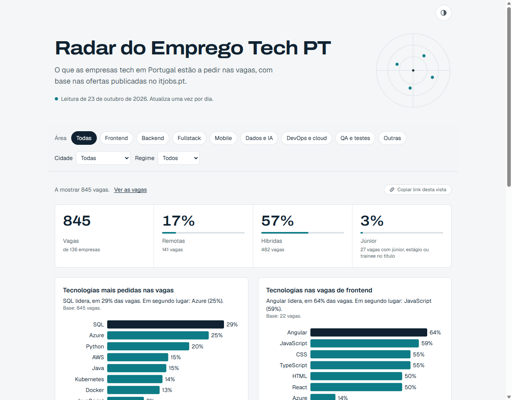
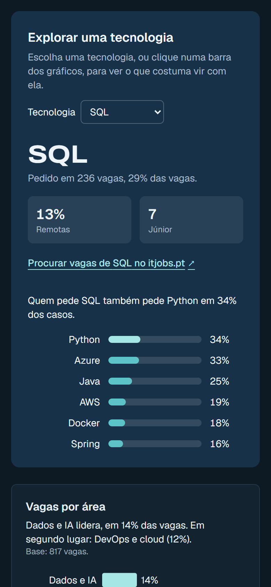

# Radar do Emprego Tech PT

**Live:** [radar-emprego-tech-pt.vercel.app](https://radar-emprego-tech-pt.vercel.app)

A dashboard that shows what tech companies in Portugal are asking for in their job ads:
the most requested technologies, which areas are hiring, where the jobs are and how much of the work is
remote, hybrid or on-site. It uses real, daily-updated data from the [itjobs.pt](https://www.itjobs.pt) API.



<p align="center">
  
</p>

## What it does

- Filters by area (frontend, backend, fullstack, mobile, data, DevOps, QA), city and work model. Filters
  live in the URL, so any view can be shared with one click and survives a reload or the back button.
- Every chart opens with a one-line takeaway written from the data ("SQL lidera, em 29% das vagas…") and
  shows percentages with the number of jobs behind them.
- A technology explorer: pick a technology, or click its bar, to see what the same job ads also ask for
  ("Quem pede React também pede JavaScript em 54% dos casos"), with a link to those jobs on itjobs.pt.
- A "how the data is handled" section explains the rules and their limits.

## How it works

1. **Fetching** (`src/lib/itjobs.ts`) — the server calls `job/list.json` page by page. Responses are cached
   for 24 hours, so the API is hit at most once a day. The API key only lives on the server.
2. **Normalising** (`src/lib/normalize.ts`) — each job is reduced to what the dashboard needs: technologies
   (matched against a closed list, with care for look-alikes such as Java/JavaScript or React/React Native),
   area (from the title, or from the technologies when the title is generic), work model and seniority.
3. **Aggregating** (`src/lib/aggregate.ts`, `src/lib/insights.ts`) — plain, tested functions count jobs and
   write the takeaway sentence of each chart.
4. **Filtering** (`src/components/Dashboard.tsx`) — the page is rendered once a day on the server; filtering
   then happens in the browser, in React state mirrored to the URL.
5. **Drawing** (`src/components/BarChart.tsx`) — D3 computes the scales and React renders the SVG. The chart
   measures its own width so labels stay readable on phones.

## Accessibility

Lighthouse scores 100 in light and dark mode, on desktop and mobile. Beyond that it was checked by hand:
keyboard-only use, Windows high contrast mode, a 320px wide screen and the heading structure. Each chart has
an `h2` and a visually hidden table with the same data; filter buttons expose their state with
`aria-pressed`, and the job count is announced to screen readers when the filters change.

## Stack

Next.js (App Router) · TypeScript · Tailwind CSS · D3.js · Vitest + Testing Library

## Running locally

```bash
npm install
cp .env.example .env.local   # then add your itjobs.pt API key (https://itjobs.pt/api)
npm run dev                  # http://localhost:3000
npm test
```

Without an API key, or if the API fails, the page falls back to sample data and says so.

## Data

Data from [itjobs.pt](https://www.itjobs.pt), used with their permission. Only aggregated numbers are shown;
individual job ads are not republished.
